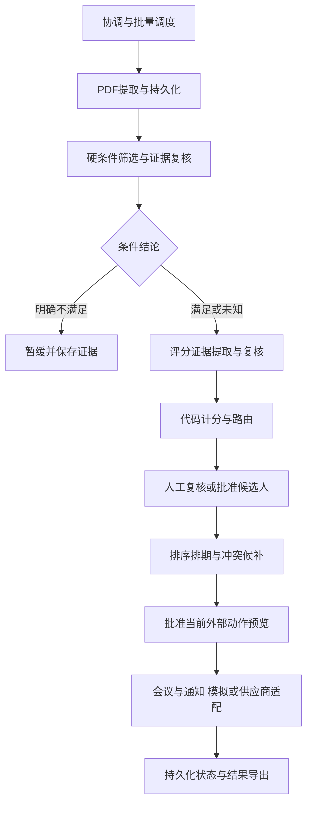

# 招聘项目审查与验收记录

日期：2026-11-16。结论：具备可测试的核心工作流，本轮完成外部动作模拟链路和超时保护；尚不能认定全面生产验收完成。工作区存在大量原有未提交改动，本轮未覆盖、回滚或提交这些改动。

## 原始需求及追踪矩阵

来源为用户指定题目 PDF 的全部一页内容。P0 表示题目明确要求；P1/P2 为本次工程建议，不能解释为原题要求。原题没有指定 API 协议、数据库、Docker、延迟数值、Accuracy 目标或必须使用真实服务，明确允许 Mock。

|ID/级别|需求|代码位置（相对仓库）|测试/验收证据|状态|
|---|---|---|---|---|
|R01 P0|可运行多智能体框架，约214份PDF；现场演示几份并说明扩展|backend/app/agents/recruitment_agent/recruitment_graph.py；services/workflow_service/runtime.py|test/integration/test_business.py、test_unified_hiring.py|合成测试覆盖；未跑214份真实数据|
|R02 P0|海外钢结构/MiC负责人；相关领域；8年工作或5年直接相关；项目或团队管理|app/conf/initial_job.json；nodes/screen_hard_conditions.py|test_hard_conditions_first.py、test_screening_rules.py|规则测试覆盖；语义准确率待实测|
|R03 P0|评分30/15/15/15/10/5/5/5，总分100|initial_job.json；nodes/calculate_score.py|test_hard_conditions_first.py、test_rules_and_model.py|确定性计分覆盖|
|R04 P0|≥75推荐、60–74复核、<60暂缓；缺失转复核|nodes/calculate_score.py；decision.py|test_rules_and_model.py；test_verified_evidence_flow.py|边界和缺失覆盖|
|R05 P0|结论必须有原文证据，不得编造|scoring.py:valid_evidence；nodes/verify_hard_conditions.py、verify_scoring_evidence.py|test_evidence_checks.py、test_verified_evidence_flow.py|定位校验覆盖；不能证明所有语义结论正确|
|R06 P0|共享State、条件路由、批量/并行|recruitment_state.py；recruitment_graph.py；services/workflow_service/runtime.py|test_business.py、test_unified_hiring.py|Mock集成覆盖|
|R07 P0|人工审批后恢复|nodes/human_review.py；services/review_service/reviews.py|test_recovery.py、test_cached_review_recovery.py|Mock/SQLite覆盖；MySQL恢复跳过|
|R08 P0|异常重试、日志、幂等|clients/llm_client.py；core/logging.py；services/schedule_service/actions.py|test_llm_structure.py、test_execution_logging.py、test_action_reconciliation.py|通过离线测试|
|R09 P0|4个模拟45分钟时段；总分>MiC>海外>管理；冲突候补不重复|services/schedule_service/scheduling.py；interviews.py|test_business.py、test_generated_scheduling.py、test_slot_duration.py|合成测试覆盖|
|R10 P0|会议创建与通知，未经批准不得执行真实动作|clients/mock_external.py；services/schedule_service/actions.py|新增test_mock_external.py；test_business.py|可显式模拟；真实供应商未接入|
|R11 P0|每人姓名、结论、总分/分项、证据、缺失、风险、排期/会议/通知状态|services/resume_service/resumes.py；services/workflow_service/operations.py；frontend/src/views|test_business.py、test_evaluation_management.py|导出/接口覆盖|
|R12 P0|代码、图/节点说明、关键输出、README；演示分支/审批恢复/冲突/追踪|backend/README.md；app/agents/README.md；docs/architecture|后端158项通过；浏览器另记|真实现场演示待完成|
|R13 P0|不得依据年龄、性别、婚育、民族等评分|nodes/analyze_resume.py:redact；app/prompts|test_prompt_templates.py；test_evidence_checks.py|部分防护；混合中英文/同一行信息需更完整公平性评估|
|E01 P1|配置、健康、请求追踪、统一错误、部署说明|core/config.py、main.py、api/health_router.py、Dockerfile|test_foundation.py、test_execution_logging.py|已有实现；部署未现场验证|
|E02 P1|准确率和延迟评估，可复现统一数据集|scripts/evaluate_routes.py；tmp/audit-route-metrics.json|6种合成边界各100次|仅历史确定性路由，不代表LLM准确率|
|E03 P1|外部调用超时保护|services/schedule_service/actions.py|新增test_mock_external.py|本轮修复|
|E04 P2|真实供应商接入及大规模负载测试|clients/meeting_client.py、notification_client.py|无真实验收|待选供应商和专用数据环境|

## 问题清单、原因与处置

|级别|位置/函数|触发与影响|修复/建议及状态|
|---|---|---|---|
|P0交付缺口|MeetingClient.create、NotificationClient.send|始终未配置，审批后无法演示成功的完整动作链|新增显式 Mock 适配器，默认关闭；provider=mock、simulated=true；继续复用原审批、状态、幂等流程。真实平台仍未接入|
|P1|ActionService.execute/reconcile|适配器不返回时锁长期占用，后续请求堆积|新增可配置 asyncio.timeout；创建/发送超时为 uncertain，禁止盲目重发；查询超时继续待核实；回归测试通过|
|P1|backend/README.md 首段|文档称两次模型调用及v1，代码已为v2，误导性能/成本估算|已同步：硬条件淘汰通常2次，其余单段通常4次，重试和分段另计|
|P1待处理|api/dependencies.py 与各业务router|未发现身份认证/授权依赖，局域网/公网暴露后操作者名称不能代表可信身份|生产部署前增加认证、岗位/对象级授权；本轮不擅自改变现有API契约，当前仅适合作为可信环境演示|
|P1待评估|nodes/analyze_resume.py:redact|按中文关键词删整行，可能漏英文属性或连带删除同行工作经历，影响公平性和召回|需统一双语属性测试集；不能直接扩大关键词删除来宣称准确率提升|
|P1待验收|nodes/extract_scoring_evidence.py、calculate_score.py|命中维度给全分，未命中给零分；题目只给维度上限，未要求此评分粒度|保留当前业务规则，需人工标注验证是否过粗；未经数据对比不重写评分体系|
|P1待验收|nodes/screen_hard_conditions.py|硬条件正文超预算直接报错；扫描PDF无OCR|已有明确错误，未静默截断；真实数据需统计长简历/扫描件占比，再决定分段/OCR策略|
|P2|静态检查|仓库级ruff默认检查71个可自动修复项；E/F检查另外发现39处行长|没有批量格式化用户现有改动；新增核心文件F检查通过|
|环境限制|AGENTS.md与工具注册|指定workbuddy工具及脚本缺失；AGENTS说未初始化Git但实际存在.git|未宣称联通，未并行修改；未创建提交或分支|

## 架构与性能判断

识别任务实际是简历事实/证据提取、硬条件三态判定、评分项匹配和候选人路由，并非通用意图分类。保留 LangGraph、共享状态、规则快照和原图兼容；代码负责可确定性分数/阈值/日程，不额外引入框架。PDF已通过to_thread避免阻塞；模型HTTP客户端复用、并发信号量、最多三次请求重试、人工中断恢复及外部幂等均已存在。不为减少调用而移除既有证据复核，因为尚无准确率数据支持。

## 验证记录与限制

- 后端全套：`backend/.venv/Scripts/python.exe -m pytest -q`，158 passed、5 skipped、34.44秒（含本轮2项新增测试）。日志：tmp/audit-tests.txt。SQLite、Mock与真实MySQL/模型严格区分。未取得修复前完整套件结果，不能据此宣称回归数量或失败率改善。
- 前端规则：5 passed；`npm run build`通过，主包约1.08 MB，有体积警告。
- Playwright默认Chromium缺失导致10项启动失败，不能解释为业务断言失败；使用本机Edge重试，最终结果见附录。
- Windows受限环境测试阻塞于asyncio socketpair，使用沙箱外运行完成后端回归；停止本轮遗留阻塞进程，未修改应用事件循环。
- 6种合成历史路由边界、100次重复，共600次，Accuracy及各类P/R/F1为1，混淆矩阵对角各200；这是确定性规则自检，不是600份独立简历。平均0.0197 ms，P50 0.0175、P95 0.0315、P99 0.0456 ms，仅测summarize，不含数据库/模型/网络。0次模型调用，0 token。不作为性能提升证据。
- 真实LLM语义Accuracy、混淆矩阵、工具路由正确率、结构化输出有效率、失败/异常率、端到端延迟、TTFT、吞吐量、并发成功率均未实测，记为未验收。当前无流式输出，TTFT不适用。输入/输出token已有调用日志采集，但无本轮真实调用数据。未修改模型识别策略，因此没有优化前后语义准确率提升结论。

下一轮真实验收应使用脱敏且经业务人工标注的同一组简历，覆盖正常、相似、模糊、缺失、异常、注入及受保护属性变化；固定模型/规则/提示词版本，用改前和改后分别运行，保存逐例预测、证据、路由、schema校验、调用次数、usage及阶段耗时；对同一专用数据库测试1/3/10并发，再输出准确率与延迟对照。未提供该标注集和真实模型验收结果前，不能把Mock结果升级为真实验收。

### 浏览器验收附录

本机Edge执行完成：5 passed、5 failed，耗时2.1分钟，日志 tmp/audit-e2e-edge.txt。这批测试多数使用HTTP拦截，不等同真实前后端端到端验收。失败仍待修复，不能标为交付通过：

|测试位置|直接失败证据|关联实现/下一步|
|---|---|---|
|frontend/tests/evaluations.spec.ts|等待“统一排期”按钮超时|核对当前面试抽屉交互与测试的旧批次排期流程|
|frontend/tests/hard-condition-scoring.spec.ts|找不到默认blockquote|CandidateDetailView.vue已使用证据按钮打开原文；测试需验证点击后的原文展示，不能删除证据断言|
|frontend/tests/human-workflow.spec.ts|Unexpected request: /api/interviews|测试仍Mock /api/scheduling-records，需按当前API补齐Mock后再判断页面行为|
|frontend/tests/jobs.spec.ts|岗位行内“删除”按钮等待超时|核对当前岗位操作菜单及删除确认流程|
|frontend/tests/resumes.spec.ts|等待“详情”按钮超时|核对当前简历工作区详情入口和可访问名称|

浏览器失败与真实模型数据缺失意味着本次尚未满足“全面修复、全部回归与准确率/性能前后对比”的完整目标。以上明确保留为未完成项。
